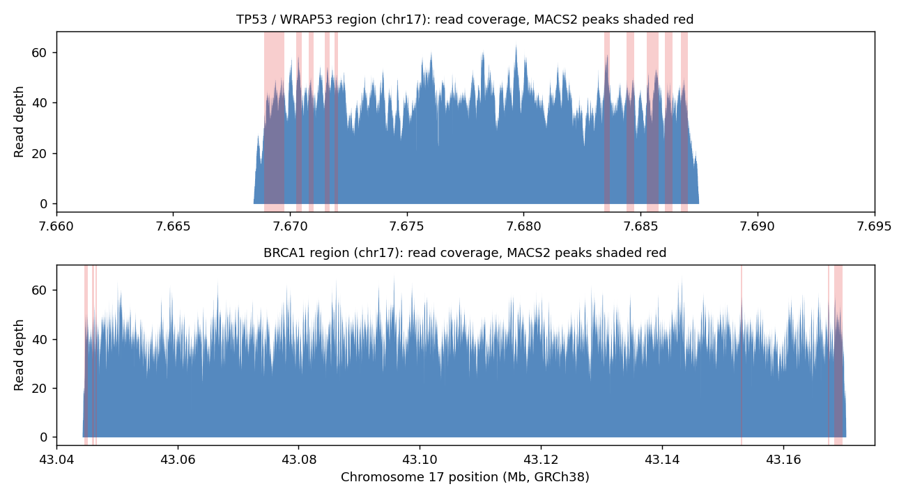

# NGS Pipeline: Paired-End Reads to Annotated Genes (Chromosome 17)

**Goal:** build an end-to-end pipeline that takes raw paired-end sequencing reads, checks their quality, aligns them to the human reference genome, finds high-coverage regions, and identifies the genes they fall in.

**Result:** all 39,998 reads (19,999 pairs) aligned to chromosome 17 (100% mapped, about 1 mismatch per 150-base read, 99.9% with mapping quality 30 or higher). The 16 high-coverage peaks fell in **TP53**, **WRAP53**, and **BRCA1**, which matches the regions this course dataset's reads were generated from, confirming the pipeline traced reads back to the correct genes.



## Pipeline
| Step | Tool | Output |
|---|---|---|
| 1. Quality check | Python + Biopython (`quality_check.py`) | Read counts and mean Phred quality per file |
| 2. Alignment | `bwa mem` to GRCh38 chromosome 17 | SAM file |
| 3. Convert, sort, index | `samtools` | Sorted, indexed BAM; `flagstat` alignment summary |
| 4. Peak calling | `MACS2 callpeak` | 16 peaks (`results/*.narrowPeak`, summits BED) |
| 5. Gene annotation | `bedtools intersect` with the Ensembl GRCh38.112 GFF3 | Genes and transcripts overlapping peaks (`results/unique_genes.txt`) |
| 6. Visual check | IGV, plus a coverage plot from `samtools depth` | Coverage over the peak regions |

All commands are in [`pipeline.sh`](pipeline.sh).

## Quality check
Each FASTQ file contains 19,999 reads of 150 bases with a mean Phred quality of 23 (about 99.5% base-call accuracy).

## Data
A paired-end teaching dataset from Brandeis RBIF109 (Python for bioinformatics). The read names show the reads were simulated from the TP53/WRAP53 and BRCA1 regions of chromosome 17, which makes it a good test of whether the pipeline localizes reads correctly. The FASTQ, BAM, and reference files are not included because of their size; the Ensembl GRCh38 chromosome 17 FASTA and GFF3 are public.

## Limitations
- MACS2 is designed for ChIP-seq; here it is used to flag local high-coverage regions. Because coverage is fairly even across each gene, the peaks mark local maxima rather than distinct binding sites.
- The dataset is simulated, so the result validates the pipeline rather than describing a biological sample.
- `unique_genes.txt` lists both gene names (for example, TP53) and transcript names (for example, TP53-201).

## Run it
Requires Python 3 with Biopython, `bwa`, `samtools`, `MACS2`, and `bedtools` on your PATH.
```bash
bwa index Homo_sapiens.GRCh38.dna.chromosome.17.fa
./pipeline.sh
```
